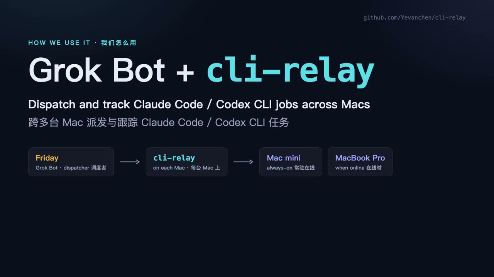

# cli-relay

**A small local ledger for Claude Code and Codex on the Macs (or Linux boxes) where you already run them.**

When a chat bot or script hands work to those CLIs, it needs three things the CLIs do not give you: the same request must not start twice, a crash or reconnect must leave a truthful status, and a finished result must stay until something has actually taken it. cli-relay does that. Your subscription login, permissions, and the CLIs themselves stay in charge of the work.

It is not a model proxy, an agent framework, a networked relay, an orchestrator, or a second terminal. It is a ledger on each machine, plus an optional wake-up when a task ends.

[](docs/media/cli-relay-grokbot-intro.mp4)

[Watch the intro (2:22, mp4)](docs/media/cli-relay-grokbot-intro.mp4) — English narration, Chinese + English captions. How [Grok Bot](https://grok.x.ai/) dispatches and tracks Claude Code / Codex jobs on more than one Mac through cli-relay.

## What you get

| | |
|---|---|
| **Same key, same task** | Resubmit the same `(scope, key)` and you get the same task back. A different payload under that key is a conflict, not a silent second run. |
| **Honest status after a break** | Attempts record host, process identity, native session id, and exit evidence. What cannot be proven is `unknown`, never guessed. |
| **Hold until ACK** | Terminal events keep a stable id and are re-delivered until a named consumer ACKs them. |
| **Wake on finish** | Optional notifier (script or webhook) can wake a consumer such as a Grok Bot routine when a task ends. A wake is not an ACK. |

## Quick start

```sh
git clone https://github.com/Yevanchen/cli-relay && cd cli-relay
pip install .            # or run in place: PYTHONPATH=. python3 -m cli_relay …
cli-relay init           # ledger under $CLI_RELAY_HOME or ~/.cli-relay

cli-relay submit --key fix-tests-42 --engine claude --cwd ~/code/app \
  --prompt "Run the unit tests and summarise failures."

cli-relay wait t-… --timeout 600    # a timeout only stops waiting; the task keeps running
cli-relay events --consumer grok    # terminal events this consumer has not ACKed yet
cli-relay ack --consumer grok --task t-… --attempt 1 --event e-…
```

Every command prints one JSON object on stdout (except `--help` / `--version`). Exit codes, `status`, `resume`, `cancel` and more: [`docs/usage.md`](docs/usage.md#commands).

With the notifier (v0.2):

```sh
cli-relay migrate                   # only for a ledger made by an older version; takes a backup first
cli-relay submit --key k --engine claude --cwd ~/code/app --prompt "…" --notify-route bot
cli-relay notify run --interval 60  # periodic pass: retries, reminders, catch-up after a restart
```

Routes are configured per machine in `<home>/notifier.json`. Configuration, route registration and verification: [`docs/notifier.md`](docs/notifier.md).

## Requirements

- macOS or Linux, Python ≥ 3.11 (stdlib only), local disk for the ledger
- For real runs: `claude` and/or `codex` installed and logged in with a **subscription** (API-key routes are refused)

## Engines

| Engine | Role |
|---|---|
| `claude` | Claude Code (`dontAsk`; tools follow your existing Claude settings) |
| `codex` | Codex (`read-only` by default; `workspace-write` / full access only with explicit options) |
| `fixture` | Local stand-in for tests |

Model and effort can be set per task with `--option`. Sandbox, network, and tool opt-ins are documented in [`docs/usage.md`](docs/usage.md#engines), and the guards behind them in [`docs/reliability.md`](docs/reliability.md) — not repeated here.

Codex automatically adds `--skip-git-repo-check` when the task directory is outside a Git work
tree. Use `--option skip_git_repo_check=true` to always skip the check, or `false` to enforce it.
The decision is recorded in attempt evidence and terminal events; sandbox defaults stay the same.

## How a consumer should use it

1. Submit with a key derived from the request. If the reply is lost, submit the same key again.
2. Wait or poll `status`. A wait timeout is not a task failure.
3. Read `events --consumer <you>`, deliver the result, then `ack`. `succeeded` means the CLI finished without an error, not that the goal was reached; for tasks such as test runs, require the [completion marker](docs/usage.md#when-the-cli-finished-is-not-the-task-is-done-the-completion-marker).
4. If the state is `unknown`, a human chooses `resume` or an explicit fresh re-run.

## Documentation

| Doc | Covers |
|---|---|
| [`docs/usage.md`](docs/usage.md) | Commands and exit codes, per-task routes, engine options (sandbox, network, tools, model/effort, completion marker), consumer workflow, limits, tests |
| [`docs/notifier.md`](docs/notifier.md) | Notifier model, `notifier.json`, route registration and verification, payload, install and rollback |
| [`docs/reliability.md`](docs/reliability.md) | State machine, crash windows, subscription and permission guards, failure model |
| [`docs/decisions.md`](docs/decisions.md) | Design decisions; comparison with the native CLIs, AGPair, Agenvo and Reason Network |
| [`docs/acceptance.md`](docs/acceptance.md) | Test matrix, how to reproduce, what has and has not been run |

## Status

Experimental. What has and has not been verified is in [`docs/acceptance.md`](docs/acceptance.md); known limits are in [`docs/usage.md`](docs/usage.md#limits). Not promised: exactly-once external side effects, that a notification reaches a chat or a person, or that a process keeps running across sleep, power loss or reboot.

## Acknowledgements

The submit de-duplication, exit-code runner, process identity and explicit-retry patterns follow [AGPair](https://github.com/logicrw/agpair) (MIT). The `unknown` execution outcome and the no-automatic-write-replay rule follow [Agenvo](https://github.com/Xuanwo/agenvo).

## License

[MIT](LICENSE)
